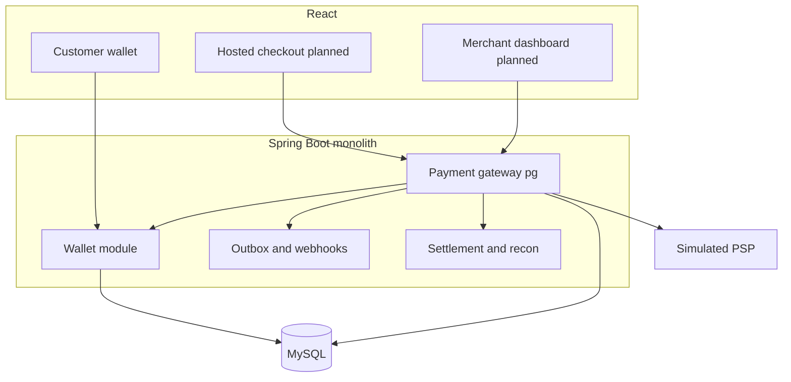
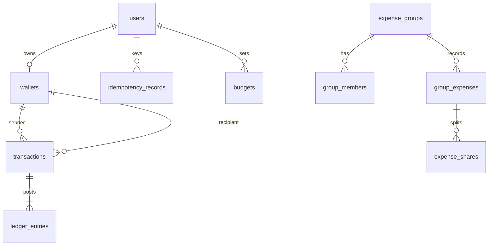

# DripPay — Your Money. Your Vibe.

Portfolio-grade **simulated** digital wallet and **merchant payment gateway**: Spring Boot + React + MySQL.

**Architecture (wallet + PG):** [docs/PAYMENT_GATEWAY_ARCHITECTURE.md](docs/PAYMENT_GATEWAY_ARCHITECTURE.md) · [docs/MODULE_MAP.md](docs/MODULE_MAP.md)

| Layer | Path | Stack |
|-------|------|--------|
| Backend | `backend/` | Java 17, Spring Boot 3.3, Maven, JWT, Flyway, JPA |
| Frontend | `frontend/` | React (Vite), Tailwind, Axios, Recharts |
| Learning sandbox | `wallet-service/` | Original Gradle tutorial wallet (optional) |

## Architecture (high level)



Details, APIs, schema, and test plan: **[docs/PAYMENT_GATEWAY_ARCHITECTURE.md](docs/PAYMENT_GATEWAY_ARCHITECTURE.md)**.

## ER diagram (core)



## Ledger reconciliation

For every **completed** money movement:

1. Wallet `balance` is updated inside a single `@Transactional` boundary.
2. Matching **ledger entries** are written (debits = credits for transfers).
3. P2P ₹500 transfer → sender **DEBIT** 500, recipient **CREDIT** 500.
4. Demo deposit → platform **DEBIT**, user **CREDIT** (platform wallet id `1`).
5. Ledger rows are append-only via application APIs (no update/delete endpoints).

## Quick start

### 1. MySQL

```bash
cp .env.example .env   # set DB_PASSWORD (empty if local root has no password)
docker compose up -d
```

### 2. Backend

```bash
export JAVA_HOME="$([/usr/libexec/java_home -v 17] 2>/dev/null || echo /path/to/jdk-17)"
cd backend
./mvnw spring-boot:run
```

- API: `http://localhost:8080/api/v1`
- Swagger UI: `http://localhost:8080/swagger-ui.html`

### 3. Frontend

```bash
cd frontend
npm install
npm run dev
```

Open `http://localhost:5173`

## Demo accounts (seeded on startup)

| Email | Password | Role |
|-------|----------|------|
| `demo@drippay.app` | `Demo1234!` | USER |
| `admin@drippay.app` | `Admin1234!` | ADMIN |

## SafeTransfer

- `POST /api/v1/transfers` with header `Idempotency-Key`
- Pessimistic wallet locks (consistent lock order)
- `BigDecimal` amounts, non-negative balance DB check

## Tests

```bash
cd backend && mvn test
./scripts/run-backend-tests.sh
BASE_URL=http://localhost:8080/api/v1 ./scripts/e2e-smoke.sh
```

Manual test cases and QA reports: **[reports/README.md](reports/README.md)** · [Manual test cases](reports/DripPay_Manual_Test_Cases.md)

## Postman

Import `postman/DripPay.postman_collection.json`.

## Disclaimer

**Simulated funds only.** Not a regulated payment service. No real banking integration.
