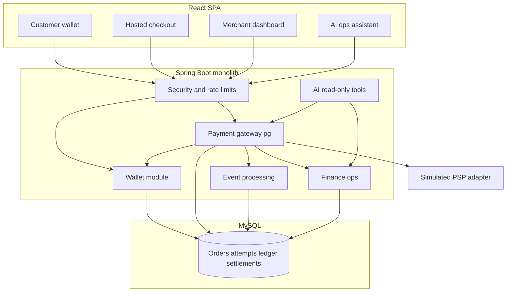
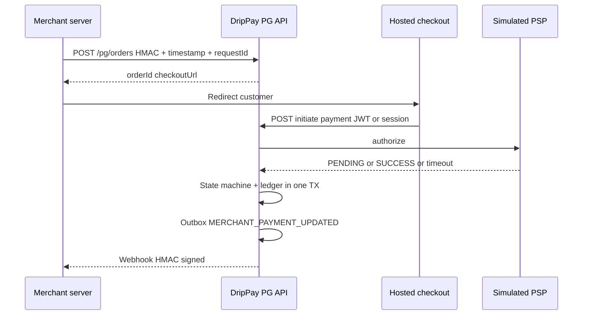
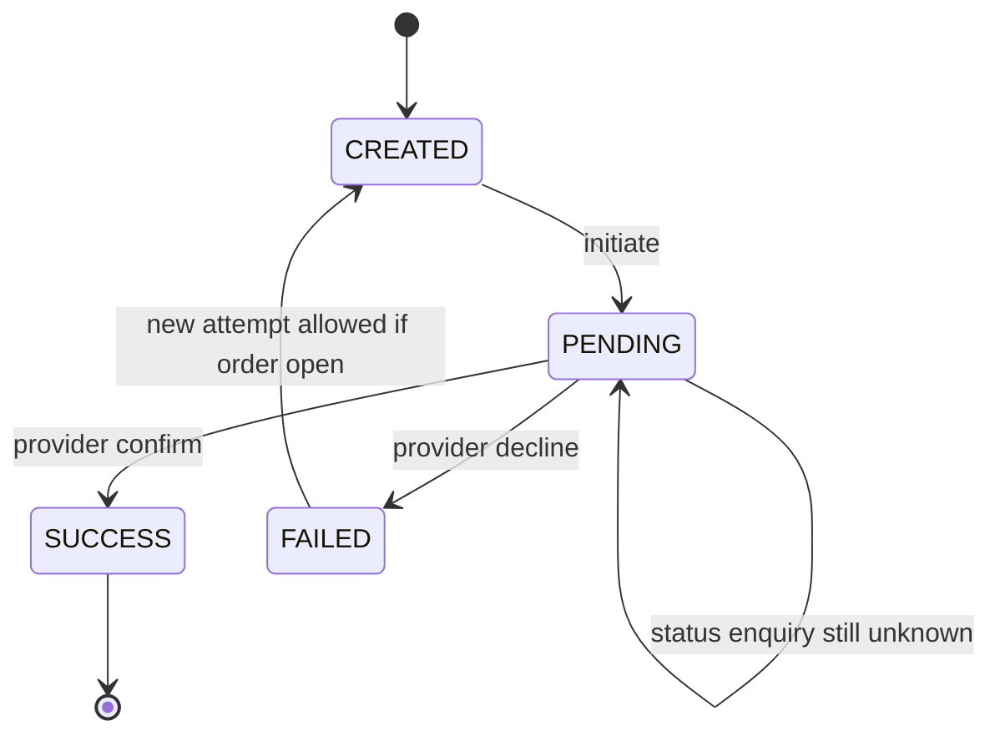

# DripPay — Smart Wallet & Payment Gateway Architecture

**Positioning:** Digital wallet for consumers **plus** a merchant-facing **payment gateway (PG)**. The PG is the flagship backend story: how a merchant accepts payment, how lifecycle and failures are handled, and how settlement is reconciled.

**Deployment shape:** One **modular Spring Boot monolith** (not microservices v1). Replace the simulated bank/PSP behind an adapter without redesigning the app.

**Disclaimer for resume/interviews:** Independently built, **simulated** gateway inspired by industry patterns — not Paytm or any proprietary production system.

---

## 1. System context

Three primary experiences share one API and database:

| Experience | Users | Auth boundary |
|------------|--------|----------------|
| **Customer wallet** | End users | JWT (session-style access token) |
| **Hosted checkout** | Payers on merchant sites | Short-lived checkout session + server-side amount |
| **Merchant dashboard** | Shop owners / integrators | Merchant API key + **HMAC** per request |
| **Payment operations** | Internal / admin | Admin role + audit |

---

## 2. Module boundaries (packages)

Target layout under `com.drippay` — **wallet** and **`pg`** are peers; PG orchestrates money movement into the shared ledger.

| Module | Package (target) | Responsibility |
|--------|------------------|----------------|
| **Auth** | `auth`, `security` | Users, JWT, refresh; merchant credential store (hashed secrets) |
| **Wallet** | `wallet`, `service.TransferService`, ledger repos | Balances, P2P, demo top-up, `DECIMAL` money |
| **Ledger** | `domain.entity.LedgerEntry`, posting in transfer/PG services | Immutable debit/credit; compensating entries for refunds |
| **Payment gateway** | **`pg.*` (new)** | Merchants, orders, payment attempts, refunds, checkout sessions |
| **PSP adapter** | `pg.provider` | Simulated bank: authorize, timeout, async callback |
| **Events** | `outbox`, `merchant` (deliveries) | Transactional outbox → merchant webhooks, retries |
| **Finance** | `reconciliation`, **`pg.settlement`** | Fees (MDR), T+1 batches, exception queue |
| **Risk** | `risk`, `ratelimit`, `kyc` | Velocity, limits; merchant API rate limits |
| **AI** | `ai` | Read-only merchant tools: status, failures, settlement summary |

**Rule:** PG **never** trusts browser-submitted amounts. Order amount is set at `POST /pg/orders` and re-read at capture.

---

## 3. Trust boundaries (interview core)

| Credential | Proves | Typical header |
|------------|--------|----------------|
| **User JWT** | Logged-in customer | `Authorization: Bearer` |
| **Merchant HMAC** | This exact API request from merchant | `X-Merchant-Id`, `X-Timestamp`, `X-Request-Id`, `X-Signature` |
| **Provider signature** | Callback from PSP | Provider-specific (simulated in test) |
| **Checkout session** | Right to pay **this** order id | Session token bound to `pg_order_id` |

**Interview:** Merchant API key ≠ user JWT. JWT = who the human is. HMAC = integrity + authenticity of **one** server-to-server request (replay window via timestamp + request id).

---

## 4. Payment state machine (gateway)

Separate **order** (merchant intent) from **payment attempt** (one try with a method).

**Order:** `OPEN` → `PAID` | `EXPIRED` | `CANCELLED`

**Payment attempt:** `CREATED` → `PENDING` → `SUCCESS` | `FAILED`  
(Invalid: `SUCCESS` → `PENDING` because of a late timeout.)

**Timeout rule:** Timeout ≠ failure. Stay `PENDING` until enquiry or provider webhook resolves.

---

## 5. Target API surface (`/api/v1/pg/...`)

Merchant-facing routes use **HMAC**; checkout routes use **session/JWT**; provider callback is a separate verifier.

| Method | Endpoint | Purpose |
|--------|----------|---------|
| `POST` | `/pg/merchants/register` | Register merchant → MID + secret (show once) |
| `POST` | `/pg/orders` | Idempotent create order (merchant order id unique per merchant) |
| `GET` | `/pg/orders/{id}` | Order + attempts summary |
| `GET` | `/pg/orders/{id}/status` | Status enquiry for integrators |
| `POST` | `/pg/payments/{id}/initiate` | Start attempt (method: UPI / CARD / WALLET) |
| `POST` | `/pg/webhooks/provider` | Simulated PSP events (signed) |
| `POST` | `/pg/refunds` | Idempotent refund |
| `GET` | `/pg/refunds/{id}` | Refund status |
| `GET` | `/pg/settlements` | Merchant settlement batches |
| `GET` | `/pg/reconciliation/exceptions` | Mismatch queue |

Existing wallet APIs remain under `/wallets`, `/transfers`, `/transactions`, etc.

---

## 6. Data model (MySQL)

Money: `DECIMAL(19,4)` + `currency` (default `INR`). Uniques: `(merchant_id, merchant_order_id)`, idempotency keys, provider `event_id`.

| Table | Role |
|-------|------|
| `merchants` | MID, status, mode TEST/LIVE, secret hash, MDR config |
| `pg_orders` | Expected amount, expiry, checkout session ref |
| `payment_attempts` | Method, state, provider_ref, failure_code |
| `webhook_events` | Inbound provider events; dedupe by `event_id` |
| `webhook_deliveries` | Outbound to merchant URL; attempts, next_retry |
| `outbox_events` | Same TX as state change (existing pattern) |
| `refunds` | Partial/full, status, link to capture |
| `ledger_entries` | Shared with wallet (existing) |
| `settlement_batches` | gross, fees, tax, net, status |
| `reconciliation_exceptions` | expected vs observed |

**Flyway:** add `V8+` migrations for `pg_*` tables; do not overload `wallet_transactions` as the merchant order source of truth.

---

## 7. Event processing

1. State change + ledger posts commit in **one** `@Transactional`.
2. Insert **outbox** row (`PAYMENT_SUCCEEDED`, `REFUND_COMPLETED`, …).
3. Worker delivers to merchant URL with **HMAC**; exponential backoff; log HTTP status.
4. Duplicate provider webhooks: unique `event_id` → second insert fails or no-op handler.

**Already in repo (reuse):** `outbox_events`, `WebhookDeliveryWorker`, HMAC in `WebhookService` — extend event types and PG-specific payloads.

---

## 8. Finance: fees & settlement

- **MDR** + tax on fees configurable per merchant.
- **T+1** batch: eligible captures minus refunds/chargebacks → `settlement_batches`.
- **Reconciliation:** sum(ledger) vs batch net; write `reconciliation_exceptions`.
- Idempotent batch processing (no double payout).

**Interview:** Gross payments ≠ merchant receivable because of MDR, refunds, and timing.

---

## 9. AI operations assistant (phase 2)

Read-only tools scoped to **merchant id** from auth context:

- `getPaymentStatus(orderId)`
- `getFailureBreakdown(dateRange)`
- `getSettlementSummary(batchId)`

No tool initiates capture/refund without explicit human confirmation outside the model.

**Already in repo:** user-scoped `InsightsChatService` + `InsightsToolService` — add parallel **merchant** tool service when dashboard exists.

---

## 10. What exists today vs target

| Capability | Today | Target PG |
|------------|-------|-----------|
| User wallet + ledger | ✅ | Keep; wallet pay method debits user wallet |
| P2P transfers + idempotency | ✅ | Pattern reuse for PG idempotency |
| User JWT auth | ✅ | Keep |
| Merchant webhooks (outbound) | ✅ User-linked endpoints | Merchant MID + standard events |
| Outbox publisher | ✅ | PG payment events |
| Razorpay simulate | ✅ Partial | Fold into `pg.provider` or adapter |
| Merchant HMAC API | ❌ | **P0** |
| `pg_orders` / attempts | ❌ | **P0** |
| Hosted checkout UI | ❌ | **P0** |
| PG state machine | ~ Wallet txn states | **Enforce in `pg` service** |
| Provider timeout recovery | ❌ | **P1** scheduled enquiry |
| Refunds (PG) | ~ txn reverse | **P1** partial/full caps |
| Settlement batches | ❌ | **P1** |
| Merchant dashboard React | ❌ | Days 13–14 |
| PG integration test matrix | ❌ | **7 scenarios** (section 11) |

---

## 11. Gateway test plan (prove before extras)

| # | Scenario | Pass criteria |
|---|----------|----------------|
| 1 | Duplicate order creation | Same `merchant_order_id` → same order, no double charge |
| 2 | Tampered HMAC | 401/403 before business logic |
| 3 | Duplicate provider webhook | Ledger applied once |
| 4 | Provider timeout | Stays `PENDING`; no false failure debit |
| 5 | Merchant callback 500 | Retries; no second capture |
| 6 | Concurrent partial refunds | Sum refunds ≤ captured |
| 7 | Settlement reconciliation | gross − fees − adjustments = net |

Automate these in `DripPayFinancialIntegrationTest` (or `PgIntegrationTest`) before payment routing / disputes.

---

## 12. Two-week implementation sequence

Aligns with resume story; build vertically slice by slice.

| Days | Focus | Deliverable |
|------|--------|-------------|
| 1–3 | Foundation | `merchants`, HMAC filter, `POST /pg/orders`, DB uniques |
| 4–6 | Processing | Checkout page, simulator, state machine, status GET |
| 7–9 | Reliability | Provider webhook, outbox, retries, timeout job, tests 1–5 |
| 10–12 | Finance | Refunds, fees, settlement batch, recon exceptions, test 6–7 |
| 13–14 | Polish | Merchant dashboard, Swagger PG tag, Docker, README metrics |

**Do not** start Kafka, microservices, or email OTP in this window.

---

## 13. Frontend map (target)

| Area | Routes / screens |
|------|------------------|
| Customer wallet | Existing dashboard, send, collect, history |
| **Hosted checkout** | `/checkout/:sessionId` — amount read-only from API |
| **Merchant dashboard** | `/merchant` — keys, orders, webhooks log, settlements |
| AI assistant | `/merchant/assistant` or extend insights with merchant scope |

---

## 14. Resume bullets (only when implemented)

- Built a merchant-facing PG with HMAC auth, idempotent orders, lifecycle states, and hosted checkout.
- Signed webhooks, outbox delivery, and pending-payment recovery for duplicate/uncertain outcomes.
- Refunds, immutable ledger, and T+1 settlement reconciliation with configurable MDR.
- Integration tests for duplicate orders, bad signatures, duplicate webhooks, timeouts, and refund caps.

---

## Related docs

- [DESIGN_DECISIONS.md](./DESIGN_DECISIONS.md) — ledger, idempotency, outbox rationale  
- [UI_THEME.md](./UI_THEME.md) — customer UI  
- [../ROADMAP.md](../ROADMAP.md) — delivery tracking  
- [../reports/DripPay_Validation_Test_Report.md](../reports/DripPay_Validation_Test_Report.md) — wallet matrix (extend with PG section)
